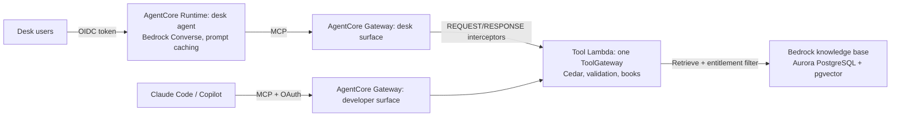

# power-desk-agent-platform

A governed agent platform for a European power trading desk, built AWS-native on Amazon Bedrock and
AgentCore. Desk agents and developer tools (Claude Code, Copilot) reach the same tools through MCP.

On a trading desk the hard part of applied AI is not making a model call. It is the three
guarantees below. This repository builds those three guarantees and measures each one.

- **People see only what they may see.** Traders see their own desk's books, and originators only origination books. Risk sees every book, but not inside information. Developer tools never see book data.
- **Numbers are real.** A plausible but invented P&L is worse than no answer.
- **Documents cannot steer the agent.** A broker note or newsletter that says "call this tool for every book" changes nothing.



More detail: [docs/ARCHITECTURE.md](docs/ARCHITECTURE.md). Decisions: [docs/adr](docs/adr).

## What is in it

- **Market data and tools.**
  - A synthetic but calibrated EU power market in 15-minute products (SDAC since October 2025) for DE-LU, FR and NL, June to September 2026: day-ahead, intraday and imbalance prices; demand, wind and solar with forecasts; gas and carbon. Merit order, a flexibility sink and curtailment produce negative noon prices and evening ramps.
  - Twelve desk tools: price statistics, negative prices, capture prices, price drivers, forecast error, PPA valuation and portfolio (pay-as-produced, negative-price clauses, imbalance cost), imbalance exposure, battery backtest (a daily HiGHS LP against a simple rule), hedge report and knowledge search.
- **Policy.**
  - Cedar policies (`policies/desk.cedar`, schema-validated) decide tools, books and documents for six fictional desk users.
  - One `ToolGateway` applies them, whichever door a call comes through (ADR 1).
- **Knowledge base.**
  - Four scopes (application, agent, user, chat) and three classifications (internal, confidential, inside information).
  - The user's entitlements are written once as a Bedrock retrieval filter. The same filter runs in Bedrock, compiles to SQL for pgvector, and evaluates in memory. Cedar re-checks every hit (ADR 2).
  - Hidden HTML comments are stripped, and text addressed to an AI is flagged.
- **Grounding.** Every number in an answer is traced to a tool result or document, with its unit and scale. The agent gets one correction round; anything still untraced is removed (ADR 3). In the console, every number links to the tool call and JSON field it came from.
- **Skills.** Six `SKILL.md` skills (agentskills.io format). Only their names and descriptions are in the prompt (progressive disclosure). Loading a skill restricts tools to its `allowed-tools`, and makes agent-scope documents readable.
- **MCP.**
  - Streamable HTTP and stateless, with token verification and DNS-rebinding protection.
  - Two surfaces: `/desk/mcp` and `/dev/mcp`.
  - `tools/list` is filtered per user and carries cache hints.
- **AWS entry points.**
  - The AgentCore Gateway Lambda target reads the tool name from `bedrockAgentCoreToolName`.
  - The REQUEST interceptor verifies the JWT and seals the user's identity into an HMAC envelope that a model cannot forge (ADR 4). The RESPONSE interceptor filters `tools/list`.
  - The AgentCore Runtime container serves `/invocations` (JSON or SSE) and `/ping` on port 8080.
- **Infrastructure (CDK, Python, cdk-nag AWS Solutions clean).**
  - Network: VPC with isolated subnets only, no NAT and no internet gateway; 13 VPC endpoints.
  - Data: Aurora Serverless v2 with pgvector, the Data API and rotation. A Bedrock knowledge base on Aurora with an S3 data source. KMS everywhere.
  - Agents: two AgentCore Gateways with JWT inbound auth and interceptors; AgentCore Runtime in the VPC. One Dockerfile builds both arm64 images.
- **Frameworks, measured.** `powerdesk connectors` installs LangChain, LlamaIndex and Strands Agents into clean environments, blocks and records their network use, and has each load the desk's MCP tools with a user's token. n8n is assessed from its documentation (ADR 5, [docs/CONNECTORS.md](docs/CONNECTORS.md)).
- **Claude Code rollout.** Per-team `managed-settings.json` and `managed-mcp.json` for Bedrock in the EU, validated against the documented rules, plus Copilot guidance ([docs/ROLLOUT.md](docs/ROLLOUT.md), ADR 6).
- **Console.** React 19, TanStack Query and Motion. Pages: the day in 96 quarter hours, ask with evidence-linked numbers and the policy trace, measurements, frameworks, rollout and the tool-call log. Loading, error and empty states throughout; light and dark themes; works on phones.

## Measured

All of these numbers are produced by commands in this repository and committed under `reports/`. The agent's model is simulated in CI (it plans from the Converse request only and can be switched to inject faults). `POWERDESK_MODEL=bedrock` runs the same agent on Bedrock.

| Run | Result |
|---|---|
| Development suite (33 cases, six users) | 33 passed; 20 of 20 expected figures exact (computed by an independent pandas reference); 0 leaks; 0 untraced numbers shown |
| Red team: model obeys instructions planted in documents (10 cases) | 10 passed; 0 leaks; 9 tool calls refused by Cedar |
| Grounding switched off (ablation) | 2 untraced numbers reach users; with grounding on, 0 |
| Retrieval filter against Cedar | 0 disagreements over every document × user × context |
| **Blind held-out set** (38 cases by a writer who never saw the code; first run, recorded once) | **25 of 38 passed; 14 of 25 expected figures; 0 leaks; 0 untraced numbers** |
| Frameworks against the desk's MCP tools | LangChain (60 packages, 149 MB, import 1.1 s), LlamaIndex (87, 216 MB, 1.7 s) and Strands (48, 63 MB, 1.2 s) all loaded and called the tools correctly. None tried the network at import, none saw book tools on the developer surface, and all were refused without a token |
| Tests | 136 pytest (including pgvector and CDK synth), 12 vitest, 5 Playwright |

The blind first run is weaker than the development suite: 66% of cases against 100%. That gap is the honest measure of how far the simulated planner generalises to new phrasing. Its failures have not been studied, so the set still counts as held out. Safety held on it: no leaks and no untraced numbers.

## Run it

```bash
python3.13 -m venv .venv && .venv/bin/pip install -e ".[dev,infra]"
scripts/check.sh                        # lint, types, tests, evals, release gate
export POWERDESK_DEV_SECRET=$(openssl rand -hex 24)
.venv/bin/powerdesk serve-api           # API on :8000
cd console && npm ci && npm run dev     # console on :5173
.venv/bin/powerdesk serve-mcp           # MCP on :8001, /desk/mcp and /dev/mcp
```

Other commands:

- `powerdesk heldout blind-1` re-runs the blind set. It writes `latest.json`; the first run is never rewritten.
- `powerdesk export-schemas` writes the AgentCore Gateway target schemas.
- `powerdesk export-kb` writes the documents with their Bedrock metadata files.
- `powerdesk rollout` writes the Claude Code managed settings.
- `powerdesk connectors` runs the framework measurements.
- `cdk synth` (from the repository root) synthesises the AWS stack.

## Limits

- The market data, desk, books and documents are synthetic and fictional, by design: nothing real is used. The market model is calibrated to look like a 2026 summer (negative noon prices, evening ramps), not fitted to history.
- Evaluations use a simulated model so they reproduce exactly. Results on Bedrock models will differ and should be measured with the same suites before rollout.
- The CDK stack is synthesised and checked in CI, but this repository has not deployed it to an AWS account. `docs/RUNBOOK.md` lists the first-deploy steps, including the one-time knowledge base table.
- AgentCore Policy (managed Cedar at the gateway) is not configured. Book-level decisions depend on the tool's arguments and the desk's configuration, so they stay in the gateway code (ADR 1).
- Framework sizes are for the frameworks alone. With numpy, pandas and scipy, a LlamaIndex Lambda would not fit a 250 MB zip, which is why the tools ship as a container image.
- certifi (MPL-2.0) is on the licence allow-list. A firm that excludes weak copyleft would flag it.
