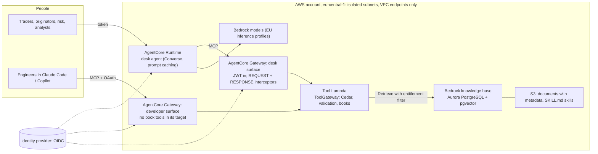

# Architecture

## A tool call, end to end

1. The client sends a JSON-RPC `tools/call` with the user's token.
2. The gateway's JWT authorizer checks the token.
3. The REQUEST interceptor verifies the token again, removes any client-supplied `_desk_identity`, and adds an HMAC-signed envelope (user, surface, expiry) (ADR 4).
4. The Lambda verifies the envelope. `ToolGateway.call` then checks, in order: the tool exists, Cedar allows invoking it, the arguments validate, and Cedar allows each book (ADR 1).
5. The tool runs over the market data or the book. Its result carries a `units` map.
6. The RESPONSE interceptor filters `tools/list` for the user. Tool results pass through unchanged.
7. The agent's answer is checked number by number against the turn's results (ADR 3).

## Where each part lives

| Part | Code | Config |
|---|---|---|
| Market model (synthetic, 15-minute) | `src/powerdesk/market` | `config/market.yaml` |
| Tools and their maths | `src/powerdesk/quant`, `src/powerdesk/tools` | `config/book.yaml` |
| Policy | `src/powerdesk/policy.py` | `policies/*.cedar`, `config/org.yaml` |
| Knowledge base | `src/powerdesk/kb` | `kb/docs/**` front matter |
| Grounding | `src/powerdesk/grounding.py` | |
| Agent and skills | `src/powerdesk/agent`, `src/powerdesk/skills.py` | `config/agent.yaml`, `skills/*/SKILL.md` |
| MCP server | `src/powerdesk/mcp_server.py` | |
| AWS entry points | `src/powerdesk/aws` | |
| Infrastructure | `infra/` (CDK + cdk-nag) | `config/infra.yaml` |
| Evaluations | `src/powerdesk/evals`, `evals/`, `heldout/` | `config/evals.yaml` |
| Framework fitness | `src/powerdesk/connectors` | `config/connectors.yaml` |
| Claude Code rollout | `src/powerdesk/rollout.py` | `config/rollout.yaml` |
| Console | `console/` (React 19, TanStack Query, Motion) | |
